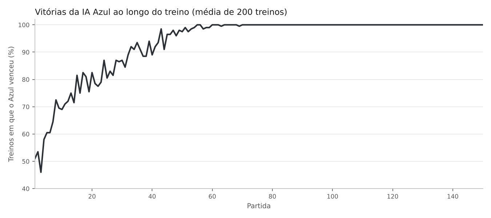

# Hexapawn com IA que aprende jogando

IA em Python que aprende a jogar **Hexapawn** do zero, sem nenhuma estratégia programada. Ela começa escolhendo jogadas ao acaso e melhora a cada partida, reforçando as jogadas que levaram à vitória e descartando as que levaram à derrota.

Projeto desenvolvido como parte da minha Iniciação Científica (programa PICTA, Centro Universitário Senac), em que estudo algoritmos de aprendizado aplicados à navegação autônoma de robôs.

## O jogo

Hexapawn é um jogo de tabuleiro 3×3 com três peões de cada lado:

- Os peões andam uma casa para frente, se ela estiver vazia, e capturam na diagonal.
- Vence quem levar um peão até o outro lado do tabuleiro, capturar todas as peças do adversário ou deixá-lo sem jogadas possíveis.

## Como a IA aprende

A ideia é inspirada no **MENACE**, a "máquina de caixas de fósforo" criada por Donald Michie em 1961 para jogar jogo da velha:

1. Para cada estado do tabuleiro, a IA guarda uma **caixinha** com todas as jogadas possíveis.
2. Na sua vez, ela sorteia uma jogada da caixinha daquele estado.
3. **Se vence**, adiciona mais uma cópia de cada jogada que usou, que passa a ter mais chance de ser sorteada.
4. **Se perde**, remove da caixinha a última jogada que fez, a que levou direto à derrota.
5. Se uma caixinha fica vazia, a IA desiste da partida, porque todas as opções daquele estado já se mostraram perdedoras.

Isso é uma forma simples de **aprendizado por reforço**: a IA não sabe as regras de estratégia, só recebe o resultado de cada partida e ajusta o próprio comportamento.

## Os dois modos

| Notebook | O que faz | Abrir |
|---|---|---|
| `hexapawn_humano_vs_ia.ipynb` | Você joga contra a IA clicando nas peças. Gráficos e histórico mostram a IA melhorando partida a partida. | [](https://colab.research.google.com/github/jonsonpalomas-tech/hexapawn-ia/blob/main/notebooks/hexapawn_humano_vs_ia.ipynb) |
| `hexapawn_ia_vs_ia.ipynb` | Duas IAs treinam uma contra a outra pelo número de partidas que você escolher, com animação opcional do tabuleiro. | [](https://colab.research.google.com/github/jonsonpalomas-tech/hexapawn-ia/blob/main/notebooks/hexapawn_ia_vs_ia.ipynb) |

Os notebooks usam widgets interativos do Google Colab. Para jogar, clique em "Abrir no Colab" e execute todas as células (Ambiente de execução → Executar tudo).

## Resultados

Para medir o aprendizado, rodei 200 treinos independentes de IA vs. IA, com 150 partidas cada, usando o script [`analise/simular_treino.py`](analise/simular_treino.py):



- No começo, as duas IAs jogam ao acaso e cada uma vence cerca de metade das partidas.
- A IA Azul, que joga em segundo, **para de perder depois de 34 partidas** (mediana dos 200 treinos). No pior caso, depois de 69.
- Isso bate com a teoria: no Hexapawn, quem joga em segundo tem uma estratégia que sempre vence. A IA descobre essa estratégia sozinha, só jogando.

Para reproduzir:

```bash
pip install matplotlib
python analise/simular_treino.py
```

## Estrutura

```
hexapawn-ia/
├── notebooks/
│   ├── hexapawn_humano_vs_ia.ipynb   # você vs. IA (interativo)
│   └── hexapawn_ia_vs_ia.ipynb       # treino IA vs. IA (interativo)
├── analise/
│   └── simular_treino.py             # simulação sem interface + gráfico
└── imagens/
    └── curva_aprendizado.png
```

## Tecnologias

Python · ipywidgets · Matplotlib · Google Colab

## Autora

**Paloma Jonson**, estudante de Engenharia de Computação no Centro Universitário Senac

[LinkedIn](https://www.linkedin.com/in/paloma-jonson) · [GitHub](https://github.com/jonsonpalomas-tech)
